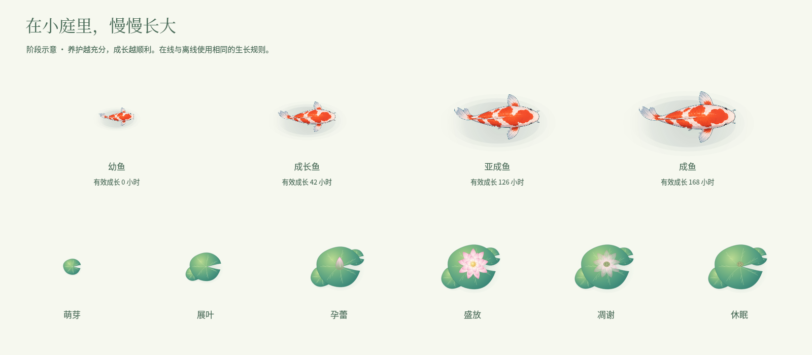
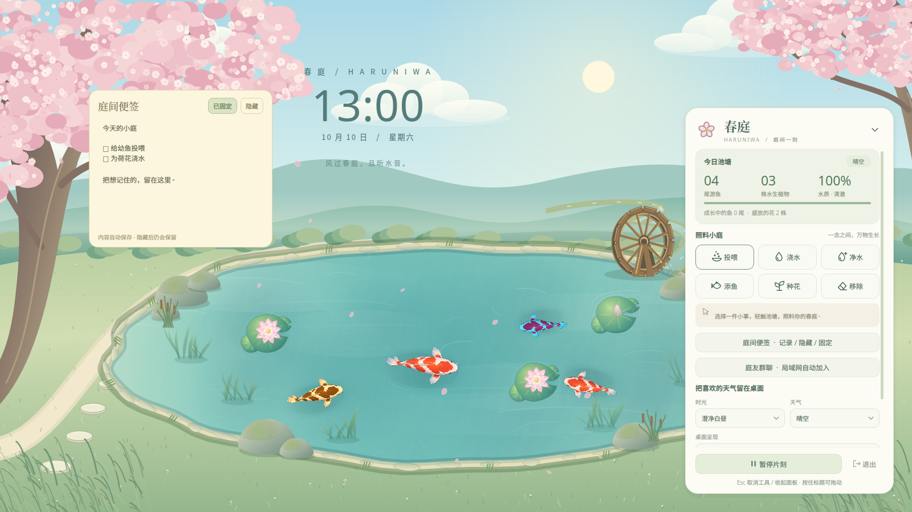
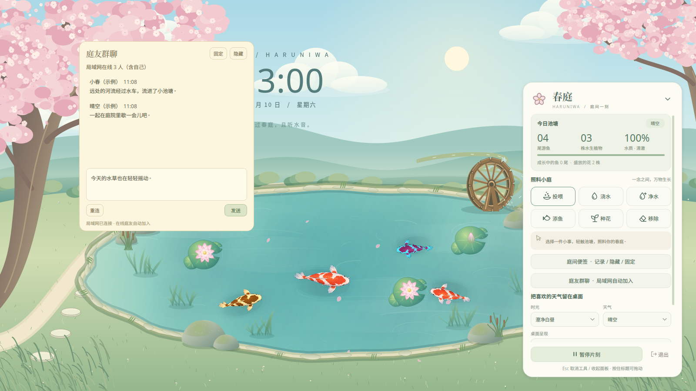

# 春庭 · Haruniwa

一方可以照料的日系动漫庭院，住进你的 Linux 桌面。晴空、远山、茶屋与樱花围绕着流动的池水，锦鲤缓缓游动，荷叶与花瓣随风轻摆。Python 3.12 + PySide6。


## 启动

已有项目虚拟环境时，在项目目录运行：

```bash
./run.sh
```

首次安装：

```bash
python3.12 -m venv .venv
.venv/bin/pip install -r requirements.txt
./run.sh
```

普通窗口预览（也适用于 Wayland）：

```bash
./run.sh --preview
```

体验独立的小庭、不使用现有存档：

```bash
./run.sh --preview --state /tmp/haruniwa-preview.json
```

可使用 `--screen 显示器名称` 指定显示器；系统托盘菜单也支持切换。

## 在桌面照料小庭

点击右下角的「春庭」胶囊打开面板。按住胶囊或面板标题可拖动；面板展开时保持右下角位置，小屏幕可滚动查看设置。

| 工具 | 用法 |
| --- | --- |
| 投喂 | 选中后轻点水面，鱼儿会靠近鱼食；水面食物过多时暂停投放 |
| 浇水 | 轻点荷叶附近，恢复植物水分 |
| 净水 | 轻点水面，恢复水质并清除剩余鱼食 |
| 添鱼 | 在水面邀请一尾新鱼，包含四种精灵配色 |
| 种花 | 种下一株水生植物，随运行时间生长开花 |
| 移除 | 轻点要移走的鱼或植物 |

再次点击选中的工具可取消；在池塘右键也可结束操作。面板或预览窗口有键盘焦点时，`Esc` 取消工具，再按一次收起面板。鱼和植物合计最多 50 个。

- **完整场景**：不透明的动漫庭院动态壁纸。
- **透明池塘**：保留原有壁纸，在其上叠加池塘，可分别关闭樱花和时钟。
- **时光与天气**：时光默认跟随北京时间（Asia/Shanghai），可固定白昼、黄昏或月夜；天气为应用内模拟，可自然变化或固定晴空、薄云、细雨、初雪，不读取网络天气。
- **动画与休息**：可选 24 / 30 / 60 FPS；暂停会停止动画与生长。时钟在暂停时也保持暂停画面。
- **桌面入口**：支持系统托盘的桌面可找回控制面板、暂停、切换场景或显示器、保存退出。

## 生长与养护

新加入的鱼从幼鱼开始，体型连续增长，依次经历幼鱼、成长鱼、亚成鱼、成鱼阶段。四种鱼采用不同的成熟周期：

| 鱼类 | 理想养护下的有效成长时间 |
| --- | --- |
| 霓虹鱼 | 48 小时 |
| 斗鱼 | 72 小时 |
| 金鱼 | 120 小时 |
| 锦鲤 | 168 小时 |

这是按现实小时推进、缩短周期的养护模拟，不是现实鱼类的生物学寿命。饥饿、水质变差和健康下降会减慢成长；规律投喂、净水可恢复健康和成长速度。进入老成阶段后仍留在池塘，不会突然消失。旧存档中的鱼保持原有成年体型。

新种的荷花从新芽开始，约在有效生长 6 小时展叶、18 小时孕蕾、30 小时首次开花。之后按 48 小时周期经历盛放、凋谢、休眠、再次孕蕾和开花。水分与健康会影响生长速度，缺水时叶片会变暗、花朵减弱；浇水后可恢复。

将鼠标停在「今日池塘」下的生长统计上，可查看每尾鱼和每株花的阶段、年龄及养护状态；在预览或工具交互模式中悬停生物也可查看。切换昼夜画面不会快进生长；暂停动画时生长暂停。在线和离线使用同一套养护计算，离线最多结算 12 小时，并随存档保存成长进度。



## 庭间便签

通过照料面板的「庭间便签」、胶囊右键菜单或托盘的「打开便签」进入。

- 支持多行纯文本，停止输入约 0.6 秒后自动保存；退出应用时会保存尚未触发自动保存的文字。
- 「隐藏」和便签窗口关闭只隐藏便签，保留内容，池塘继续运行；再次打开即可继续编辑。
- 「固定」会锁定拖动位置。壁纸模式下便签保持在其他窗口上方，预览模式下固定在预览界面；再次点击可解除固定。
- 未固定时可拖动标题调整位置，便签位置、隐藏状态和固定状态在重启后恢复，并适配显示器或窗口尺寸变化。
- 便签保存在个人 `data/state.json` 中，该文件已被 Git 忽略。



## 庭友群聊（局域网）

同一局域网的 Linux 电脑分别安装此版本，按上面的安装步骤运行 `./run.sh`（Wayland 使用 `--preview`），即自动进入同一个庭友群聊，无需账号或聊天服务器。安装软件本身不会启动服务；应用运行时才加入群聊，退出时断开。显示名称默认使用本机设备名。

- 从照料面板「庭友群聊」、胶囊右键菜单或托盘打开。支持多行输入，点击「发送」发送，最多 1000 字。
- 「隐藏」、Esc 或关闭聊天窗口只隐藏聊天，后台仍接收消息。胶囊与展开面板右上方显示未读数量气泡（超过 99 条显示 `99+`），点击气泡打开聊天并清零。
- 「固定」与便签相同：锁定位置，壁纸模式下置顶。位置、固定/隐藏状态和未发出的草稿随个人存档保存。
- 收到的消息只在本次运行内保留，不写入存档；记录最多保留 1000 个文本段。暂停庭院动画不影响聊天。关闭应用会停止网络收发。
- 界面显示在线人数及连接状态；切换网络或连接失败后可点「重连」。没有其他在线成员时也可打开窗口，但不会离线补发。

网络使用 IPv4 UDP 端口 `45873`、组播地址 `239.255.73.41`，TTL 为 1，在可用的局域网网卡上自动发现。各设备需处于允许组播互通的同一网段；访客 Wi-Fi、客户端隔离或防火墙拦截会影响连接，需要允许本地 UDP `45873` 通信。应用不会修改防火墙。此版本未提供跨公网聊天。

这是无身份认证、未加密的局域网公开群聊：同网段运行该协议的设备可以接收消息。消息会重复发送并去重以减少丢失，但不保证送达，不提供离线历史同步。



## 退出壁纸模式

点击面板的「退出」，或右键「春庭」胶囊选择「保存并退出」。面板或预览窗口有键盘焦点时，也可按 `Ctrl+Q`。通过窗口管理器关闭独立控制面板同样会退出整个应用；`Esc` 仍用于取消工具或收起面板。

面板不可见时，可从同一用户、同一桌面会话的终端正常退出：

```bash
./run.sh --quit
```

若启动时指定了独立存档，退出时使用相同路径：

```bash
./run.sh --quit --state /tmp/haruniwa-preview.json
```

命令通过本地控制接口请求保存退出，不会搜索或终止其他进程；找不到对应实例时会提示并返回非零状态。同一会话中重复启动相同存档会显示已有控制面板。

从终端启动时，`Ctrl+C` 和 `SIGTERM` 也会走正常退出流程，动画暂停时仍然有效。退出会停止动画、保存、分层维护及提示定时器，关闭壁纸、交互层、控制面板和便签，释放本地控制接口及 X11 连接。存档写入失败会记录错误并继续退出，保留原存档。

## 桌面兼容性

X11 壁纸模式使用由窗口管理器管理的桌面窗口（DESKTOP + BELOW），画布不绕过窗口管理器、不设置始终置顶。这样 GNOME 可以将普通应用和顶部状态栏放在画布上方。视觉层的原生鼠标输入区域为空；选中工具后仅池塘区域临时启用交互层，右键结束工具操作。控制面板是独立工具窗口；便签仅在用户选择固定时置顶。

已在 Ubuntu GNOME / X11 下通过实际屏幕像素验证普通应用和顶部栏的显示、鼠标穿透及正常退出。**桌面图标兼容性仍有限制：GNOME DING 可能将图标窗口排在画布下方，当前尚不能保证图标可见。** 不再使用“绕过窗口管理器并降到根窗口底部”的方案：原始 X11 顺序不能代表合成器最终显示层级，该方案会导致画布遮住所有应用。需要桌面图标时可暂用 `--preview`。

不同合成器对桌面窗口的支持有差异；Wayland 请使用 `--preview`。应用不会修改桌面图标管理器、系统壁纸、开机启动项或桌面配置。升级后需要退出旧进程并重新启动，才会使用新的分层方式：

```bash
.venv/bin/python main.py --quit
.venv/bin/python main.py
```

## 存档

默认读取项目的 `data/state.json`，兼容旧版鱼、植物与水质数据。场景设置随存档保存，每 30 秒及正常退出时保存；通过临时文件原子替换，保存失败保留原文件。读取到损坏的存档时会在面板提示，并禁止覆盖它，可使用 `--state` 选择新文件。

离线最多结算 12 小时的生长、饥饿与水质变化。退出后不会继续运行进程。

## 验证与画面导出

```bash
QT_QPA_PLATFORM=offscreen .venv/bin/python -m unittest discover -v
QT_QPA_PLATFORM=offscreen .venv/bin/python test_render.py
```

渲染脚本使用独立示例数据，不读写用户存档。生成 `tests_out/01..12_*.png`，覆盖晴天、黄昏投喂、月夜、雨雪、透明池塘、完整面板、960×600 小屏预览、便签、生长阶段、群聊与未读气泡。可用 `--output /tmp/haruniwa-renders` 指定目录。

真实 X11 桌面分层验收（有可用的 X11 会话时）：

```bash
HARUNIWA_X11_TESTS=1 .venv/bin/python -m unittest tests.test_desktop_x11 -v
```

这项测试使用临时存档及测试窗口，验证画布受窗口管理器管理、普通应用的实际屏幕像素仍可见、顶部栏像素未被遮盖（屏幕有顶部保留区域时）、鼠标输入区域为空，并自动退出。它不验证 DING 图标遮挡问题。

精灵统计：

```bash
.venv/bin/python tools/inspect_sprites.py --output /tmp/haruniwa-sprites.json
```

## 代码结构

| 文件 | 作用 |
| --- | --- |
| `main.py`、`garden/window.py` | 启动、窗口分层、托盘、显示器和应用生命周期 |
| `garden/app_control.py` | 同会话实例控制、命令行退出与终端信号处理 |
| `garden/desktop.py` | 由窗口管理器管理的壁纸底层标记 |
| `garden/notes.py` | 自动保存、隐藏、固定与拖动便签 |
| `garden/growth.py` | 在线离线统一的生长、养护和花期循环 |
| `garden/toolbar.py` | 原生 Qt 控件组成的照料面板与设置 |
| `garden/wallpaper.py` | 按分辨率绘制并缓存的庭院背景，樱花、萤火和时钟 |
| `garden/scene.py` | 水面、天气效果、工具交互与生态更新 |
| `garden/fish.py`、`garden/plant.py` | 鱼的游动与精灵绘制，荷叶与莲花 |
| `garden/models.py`、`garden/state.py` | 状态模型、偏好设置和存储 |
| `assets/fish/` | 四类鱼各 16 帧的已有美术精灵 |

运行不需要 OpenCV。只有重建鱼精灵的 `tools/build_fish_assets.py` 需要额外安装 NumPy 和 OpenCV；其来源参考图为 `assets/style_reference_koi.png`。

### 田园动态景物

完整场景加入了圆润渐变的成组苔藓石、田野河道旁的木水车、远景蜿蜒而来的入池溪流、落水水花、摇曳水草与岸边芦苇，远景补充田垄。水车、流光和草叶随场景时间推进，暂停后一起静止；夜间降低景物亮度，雪天岸石覆上薄雪。水草位于鱼群下方，石景按画面尺寸缓存。透明池塘模式保留石头、水草和芦苇，完整溪流与水车仅在田园背景显示。水流为视觉动画，不额外改变水质或生长数值。

群聊回归测试（合成消息仅通过本机回环网卡，不会发到真实局域网）：

```bash
QT_QPA_PLATFORM=offscreen .venv/bin/python -m unittest tests.test_lan_chat -v
```
