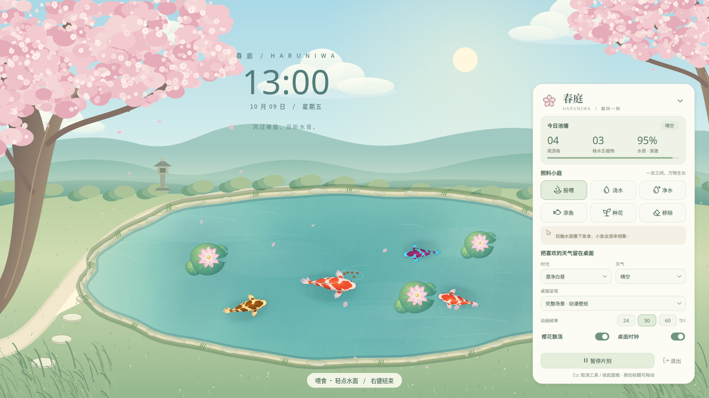

# 春庭 · Haruniwa

一方可以照料的日系动漫庭院，住进你的 Linux 桌面。晴空、远山、茶屋与樱花围绕着流动的池水，锦鲤缓缓游动，荷叶与花瓣随风轻摆。Python 3.12 + PySide6。



## 启动

已有项目虚拟环境时，在项目目录运行：

```bash
./run.sh
```

首次安装：

```bash
python3.12 -m venv .venv
.venv/bin/pip install -r requirements.txt
./run.sh
```

普通窗口预览（也适用于 Wayland）：

```bash
./run.sh --preview
```

体验独立的小庭、不使用现有存档：

```bash
./run.sh --preview --state /tmp/haruniwa-preview.json
```

可使用 `--screen 显示器名称` 指定显示器；系统托盘菜单也支持切换。

## 在桌面照料小庭

点击右下角的「春庭」胶囊打开面板。按住胶囊或面板标题可拖动；面板展开时保持右下角位置，小屏幕可滚动查看设置。

| 工具 | 用法 |
| --- | --- |
| 投喂 | 选中后轻点水面，鱼儿会靠近鱼食；水面食物过多时暂停投放 |
| 浇水 | 轻点荷叶附近，恢复植物水分 |
| 净水 | 轻点水面，恢复水质并清除剩余鱼食 |
| 添鱼 | 在水面邀请一尾新鱼，包含四种精灵配色 |
| 种花 | 种下一株水生植物，随运行时间生长开花 |
| 移除 | 轻点要移走的鱼或植物 |

再次点击选中的工具可取消；在池塘右键也可结束操作。面板或预览窗口有键盘焦点时，`Esc` 取消工具，再按一次收起面板。鱼和植物合计最多 50 个。

- **完整场景**：不透明的动漫庭院动态壁纸。
- **透明池塘**：保留原有壁纸，在其上叠加池塘，可分别关闭樱花和时钟。
- **时光与天气**：时光默认跟随北京时间（Asia/Shanghai），可固定白昼、黄昏或月夜；天气为应用内模拟，可自然变化或固定晴空、薄云、细雨、初雪，不读取网络天气。
- **动画与休息**：可选 24 / 30 / 60 FPS；暂停会停止动画与生长。时钟在暂停时也保持暂停画面。
- **桌面入口**：支持系统托盘的桌面可找回控制面板、暂停、切换场景或显示器、保存退出。

## 退出壁纸模式

点击面板的「退出」，或右键「春庭」胶囊选择「保存并退出」。面板或预览窗口有键盘焦点时，也可按 `Ctrl+Q`。通过窗口管理器关闭独立控制面板同样会退出整个应用；`Esc` 仍用于取消工具或收起面板。

面板不可见时，可从同一用户、同一桌面会话的终端正常退出：

```bash
./run.sh --quit
```

若启动时指定了独立存档，退出时使用相同路径：

```bash
./run.sh --quit --state /tmp/haruniwa-preview.json
```

命令通过本地控制接口请求保存退出，不会搜索或终止其他进程；找不到对应实例时会提示并返回非零状态。同一会话中重复启动相同存档会显示已有控制面板。

从终端启动时，`Ctrl+C` 和 `SIGTERM` 也会走正常退出流程，动画暂停时仍然有效。退出会停止动画、保存、分层维护及提示定时器，关闭壁纸、交互层和控制面板，释放本地控制接口。存档写入失败会记录错误并继续退出，保留原存档。

## 桌面兼容性

壁纸模式使用 Qt 的底层窗口与原生鼠标穿透。未选工具时，视觉层不接收鼠标；选中工具后，仅池塘区域启用单独的点击层，普通应用仍可覆盖它。控制面板是独立工具窗口，不设置始终置顶。

这是一款动态桌面窗口应用。桌面层顺序、桌面图标可见性、托盘和透明输入层取决于 Linux 桌面环境及合成器；并非所有环境都会将它当作原生系统壁纸插件。Wayland 或不支持上述窗口行为的环境，请使用 `--preview`。不会自动修改系统壁纸、开机启动项或桌面配置。

## 存档

默认读取项目的 `data/state.json`，兼容旧版鱼、植物与水质数据。场景设置随存档保存，每 30 秒及正常退出时保存；通过临时文件原子替换，保存失败保留原文件。读取到损坏的存档时会在面板提示，并禁止覆盖它，可使用 `--state` 选择新文件。

离线最多结算 12 小时的生长、饥饿与水质变化。退出后不会继续运行进程。

## 验证与画面导出

```bash
QT_QPA_PLATFORM=offscreen .venv/bin/python -m unittest discover -v
QT_QPA_PLATFORM=offscreen .venv/bin/python test_render.py
```

渲染脚本使用独立示例数据，不读写用户存档。生成 `tests_out/01..08_*.png`，覆盖晴天、黄昏投喂、月夜、雨雪、透明池塘、完整面板及 960×600 小屏预览。可用 `--output /tmp/haruniwa-renders` 指定目录。

精灵统计：

```bash
.venv/bin/python tools/inspect_sprites.py --output /tmp/haruniwa-sprites.json
```

## 代码结构

| 文件 | 作用 |
| --- | --- |
| `main.py`、`garden/window.py` | 启动、窗口分层、托盘、显示器和应用生命周期 |
| `garden/app_control.py` | 同会话实例控制、命令行退出与终端信号处理 |
| `garden/toolbar.py` | 原生 Qt 控件组成的照料面板与设置 |
| `garden/wallpaper.py` | 按分辨率绘制并缓存的庭院背景，樱花、萤火和时钟 |
| `garden/scene.py` | 水面、天气效果、工具交互与生态更新 |
| `garden/fish.py`、`garden/plant.py` | 鱼的游动与精灵绘制，荷叶与莲花 |
| `garden/models.py`、`garden/state.py` | 状态模型、偏好设置和存储 |
| `assets/fish/` | 四类鱼各 16 帧的已有美术精灵 |

运行不需要 OpenCV。只有重建鱼精灵的 `tools/build_fish_assets.py` 需要额外安装 NumPy 和 OpenCV；其来源参考图为 `assets/style_reference_koi.png`。
